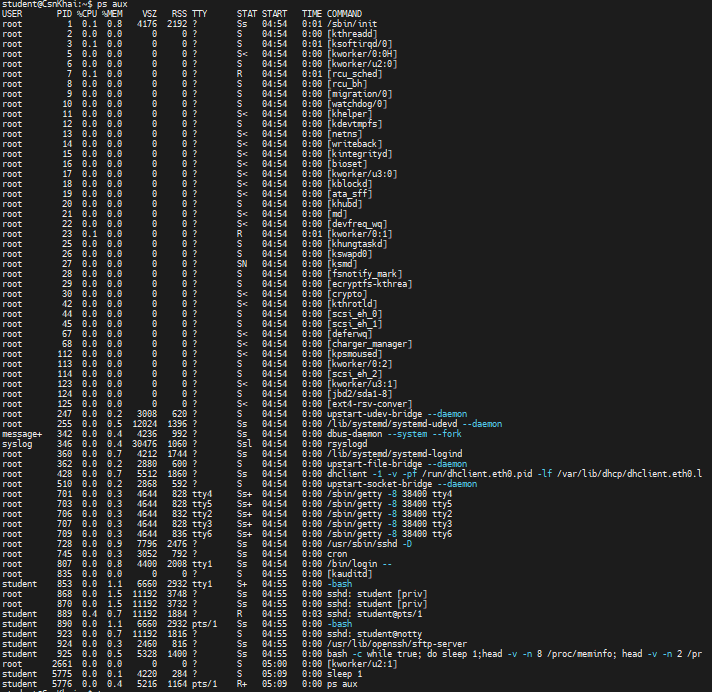
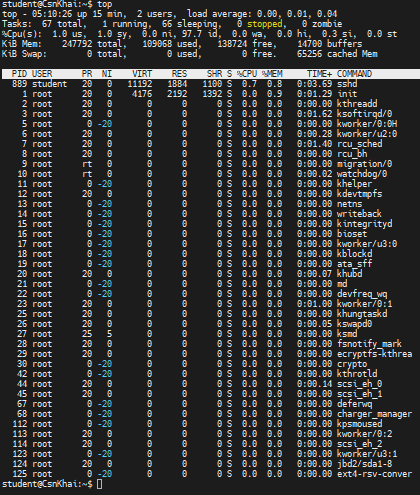
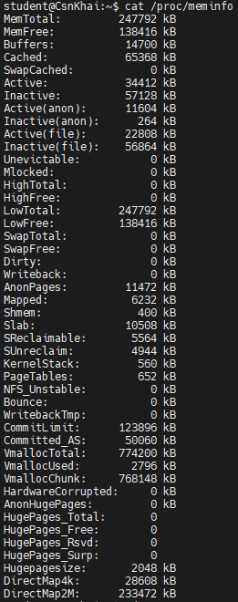
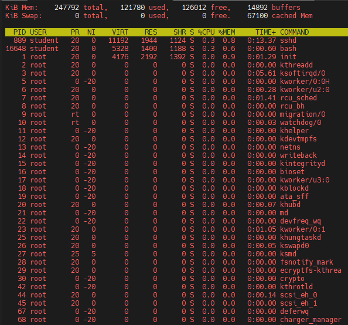

# Report on lab4

## Завдання на лабораторну роботу.

### 1. У якому стані може бути процес в linux? Використовуючи додатковий матеріал, намалюйте граф переходів.

Переглянути поточний стан процесів у системі можна за допомогою команди ps aux, top:





В операційній системі Linux процес у свій життєвий цикл може перебувати в одному з таких основних станів:

- Running / Runnable (R): Процес виконується на процесорі в даний момент або знаходиться в черзі готовності й чекає на виділення процесорного часу.
- Interruptible Sleep (S): Процес перейшов у стан очікування (наприклад, чекає на введення/виведення даних або подію). Його можна перервати сигналом.
- Uninterruptible Sleep (D): Процес чекає на завершення критичної операції (найчастіше апаратного введення/виведення, як-от зчитування з диска). Його не можна перервати сигналом до закінчення операції.
- Stopped (T): Виконання процесу зупинено (наприклад, за допомогою комбінації Ctrl+Z або через сигнал SIGSTOP). Процес чекає сигналу SIGCONT для відновлення роботи.
- Zombie (Z): Процес завершив виконання, але його батьківський процес ще не зчитав код завершення (через системний виклик wait()). Займає лише запис у таблиці процесів.
- Dead (X): Процес повністю завершено та видалено з таблиці процесів. Цей стан є кінцевим і практично не відображається утилітами спостереження.

---

### 2. Вивчіть команду pstree. Виведіть (виділіть) ланцюжок (предків) поточного процесу.

Команда pstree відображає запущені процеси у вигляді древоподібної структури, що чітко показує ієрархію між батьківськими та дочірніми процесами.

Щоб вивести та виділити ланцюжок предків для поточного процесу (оболонки, у якій виконується команда), використовується параметр -s (--show-parents) разом із передачею PID поточного процесу $$:

```
student@CsnKhai:~$ pstree -s $$
init───sshd───sshd───sshd───bash───pstree
student@CsnKhai:~$
```

Прапорці для цієї команди
- -s (--show-parents): Показує лише гілку з предками вказаного PID (звужує вивід від init/systemd до поточного процесу).
- -p (--show-pids): Додає PID (ідентифікатор процесу) у дужках до кожної назви.
- -h (--highlight-all): Виділяє поточний процес і його предків підсвічуванням (або жирним шрифтом у терміналі).

---

### 3. Що таке файлова система proc?

Файлова система proc — це віртуальна файлова система в Linux, яка монтується в каталог /proc. Вона не займає місця на жорсткому диску чи SSD, а існує виключно в оперативній пам'яті та генерується безпосередньо ядром під час звернення.

Основана мета /proc — надати зручний текстовий інтерфейс для взаємодії між простором користувача та ядром.

Для прикладу я переглянув інформацію про оперативну пам'ять



---

### 4. Виведіть інформацію про процесор (його тип, підтримувані технології тощо).

За допомогою команди cat cpuinfo я прочитав інформацію про процесор (значення виділені віртуальній машині)

```
student@CsnKhai:/proc$ cat cpuinfo
processor       : 0
vendor_id       : GenuineIntel
cpu family      : 6
model           : 63
model name      : Intel(R) Xeon(R) CPU E5-2660 v3 @ 2.60GHz
stepping        : 2
microcode       : 0xffffffff
cpu MHz         : 0.000
cache size      : 25600 KB
physical id     : 0
siblings        : 1
core id         : 0
cpu cores       : 1
apicid          : 0
initial apicid  : 0
fdiv_bug        : no
f00f_bug        : no
coma_bug        : no
fpu             : yes
fpu_exception   : yes
cpuid level     : 15
wp              : yes
flags           : fpu vme de pse tsc msr pae mce cx8 apic sep mtrr pge mca cmov pat pse36 clflush mmx fxsr sse sse2 ht nx rdtscp constant_tsc xtopology nonstop_tsc pni pclmulqdq ssse3 fma cx16 pcid sse4_1 sse4_2 movbe popcnt aes xsave avx f16c rdrand lahf_lm abm arat fsgsbase bmi1 avx2 bmi2 invpcid
bogomips        : 14366.72
clflush size    : 64
cache_alignment : 64
address sizes   : 46 bits physical, 48 bits virtual
power management:
```

Що показують ключові поля:

- model name: Назва та тип процесора (наприклад, Intel Core i7-11800H або AMD Ryzen 7 5800X).
- cpu cores / siblings: Кількість фізичних ядер та потоків.
- flags (або Features на ARM): Список підтримуваних технологій та інструкцій.

---

### 5. Візьміть id будь-якого процесу та перегляньте про нього інформацію за допомогою файлової системи proc. Яку інформацію можна отримати?

Спочатку я вікрив proc, і потім прочитав стан процесу 889

```
student    889  0.4  0.7  11192  1944 ?        R    04:55   0:16 sshd: student@pts/1
```

```
student@CsnKhai:/$ cd proc/
student@CsnKhai:/proc$ cd 889
student@CsnKhai:/proc/889$ ls -la
ls: cannot read symbolic link cwd: Permission denied
ls: cannot read symbolic link root: Permission denied
ls: cannot read symbolic link exe: Permission denied
total 0
dr-xr-xr-x  9 student student 0 Oct 22 04:55 .
dr-xr-xr-x 87 root    root    0 Oct 22 04:53 ..
dr-xr-xr-x  2 student student 0 Oct 22 05:17 attr
-rw-r--r--  1 root    root    0 Oct 22 05:17 autogroup
-r--------  1 root    root    0 Oct 22 05:17 auxv
-r--r--r--  1 root    root    0 Oct 22 05:17 cgroup
--w-------  1 root    root    0 Oct 22 05:17 clear_refs
-r--r--r--  1 root    root    0 Oct 22 04:55 cmdline
-rw-r--r--  1 root    root    0 Oct 22 05:17 comm
-rw-r--r--  1 root    root    0 Oct 22 05:17 coredump_filter
-r--r--r--  1 root    root    0 Oct 22 05:17 cpuset
lrwxrwxrwx  1 root    root    0 Oct 22 05:17 cwd
-r--------  1 root    root    0 Oct 22 05:17 environ
lrwxrwxrwx  1 root    root    0 Oct 22 05:17 exe
dr-x------  2 root    root    0 Oct 22 05:17 fd
dr-x------  2 root    root    0 Oct 22 05:17 fdinfo
-rw-r--r--  1 root    root    0 Oct 22 05:17 gid_map
-r--------  1 root    root    0 Oct 22 05:17 io
-r--r--r--  1 root    root    0 Oct 22 05:17 latency
-r--r--r--  1 root    root    0 Oct 22 05:17 limits
-rw-r--r--  1 root    root    0 Oct 22 05:17 loginuid
dr-x------  2 root    root    0 Oct 22 05:17 map_files
-r--r--r--  1 root    root    0 Oct 22 05:17 maps
-rw-------  1 root    root    0 Oct 22 05:17 mem
-r--r--r--  1 root    root    0 Oct 22 05:17 mountinfo
-r--r--r--  1 root    root    0 Oct 22 05:17 mounts
-r--------  1 root    root    0 Oct 22 05:17 mountstats
dr-xr-xr-x  5 student student 0 Oct 22 05:17 net
dr-x--x--x  2 root    root    0 Oct 22 05:17 ns
-rw-r--r--  1 root    root    0 Oct 22 05:17 oom_adj
-r--r--r--  1 root    root    0 Oct 22 05:17 oom_score
-rw-r--r--  1 root    root    0 Oct 22 05:17 oom_score_adj
-r--r--r--  1 root    root    0 Oct 22 05:17 pagemap
-r--r--r--  1 root    root    0 Oct 22 05:17 personality
-rw-r--r--  1 root    root    0 Oct 22 05:17 projid_map
lrwxrwxrwx  1 root    root    0 Oct 22 05:17 root
-rw-r--r--  1 root    root    0 Oct 22 05:17 sched
-r--r--r--  1 root    root    0 Oct 22 05:17 schedstat
-r--r--r--  1 root    root    0 Oct 22 05:17 sessionid
-rw-r--r--  1 root    root    0 Oct 22 05:17 setgroups
-r--r--r--  1 root    root    0 Oct 22 05:17 smaps
-r--r--r--  1 root    root    0 Oct 22 05:17 stack
-r--r--r--  1 root    root    0 Oct 22 04:55 stat
-r--r--r--  1 root    root    0 Oct 22 05:10 statm
-r--r--r--  1 root    root    0 Oct 22 04:55 status
-r--r--r--  1 root    root    0 Oct 22 05:17 syscall
dr-xr-xr-x  3 student student 0 Oct 22 05:13 task
-r--r--r--  1 root    root    0 Oct 22 05:17 timers
-rw-r--r--  1 root    root    0 Oct 22 05:17 uid_map
-r--r--r--  1 root    root    0 Oct 22 05:17 wchan
```

```
student@CsnKhai:/proc/889$ cat status
Name:   sshd
State:  S (sleeping)
Tgid:   889
Ngid:   0
Pid:    889
PPid:   868
TracerPid:      0
Uid:    1000    1000    1000    1000
Gid:    1000    1000    1000    1000
FDSize: 32
Groups: 4 24 27 30 46 109 110 1000
VmPeak:    11196 kB
VmSize:    11192 kB
VmLck:         0 kB
VmPin:         0 kB
VmHWM:      2040 kB
VmRSS:      2040 kB
VmData:      644 kB
VmStk:       136 kB
VmExe:       800 kB
VmLib:      6556 kB
VmPTE:        28 kB
VmSwap:        0 kB
Threads:        1
SigQ:   0/1784
SigPnd: 0000000000000000
ShdPnd: 0000000000000000
SigBlk: 0000000000000000
SigIgn: 0000000000001000
SigCgt: 0000000180010000
CapInh: 0000000000000000
CapPrm: 0000000000000000
CapEff: 0000000000000000
CapBnd: 0000001fffffffff
Seccomp:        0
Cpus_allowed:   1
Cpus_allowed_list:      0
Mems_allowed:   1
Mems_allowed_list:      0
voluntary_ctxt_switches:        41612
nonvoluntary_ctxt_switches:     13306
```

---

### 6. Використовуючи команду ps, отримайте інформацію про розглянутий раніше процес (у питанні 5). Інформація має бути наступною: власник процесу, аргументи, з якими було запущено процес виконання, група-власник цього процесу тощо.

За допомогою команди ps -fp 889 була виведена інформація:

```
student@CsnKhai:/proc/889/task/889$ ps -fp 889
UID        PID  PPID  C STIME TTY          TIME CMD
student    889   868  0 04:55 ?        00:00:09 sshd: student@pts/1
```

---

### 7. Як визначити процеси ядра та користувацькі процеси?

Ядро: Назва процесу береться безпосередньо з коду ядра і виводиться у квадратних дужках: [ksoftirqd/0], [kworker/0:0H]
```
root         2  0.0  0.0      0     0 ?        S    04:54   0:00 [kthreadd]
root         3  0.1  0.0      0     0 ?        S    04:54   0:01 [ksoftirqd/0]
root         5  0.0  0.0      0     0 ?        S<   04:54   0:00 [kworker/0:0H]
root         6  0.0  0.0      0     0 ?        S    04:54   0:00 [kworker/u2:0]
root         7  0.1  0.0      0     0 ?        R    04:54   0:01 [rcu_sched]
root         8  0.0  0.0      0     0 ?        S    04:54   0:00 [rcu_bh]
```

Користувач: Показує виконуваний файл, бінарний шлях або параметри запуску: /usr/lib/openssh/sftp-server, sshd: student@pts/1
```
root       870  0.0  1.5  11192  3732 ?        Ss   04:55   0:00 sshd: student [priv]
student    889  0.4  0.7  11192  1884 ?        R    04:55   0:03 sshd: student@pts/1
student    890  0.0  1.1   6660  2932 pts/1    Ss   04:55   0:00 -bash
student    923  0.0  0.7  11192  1816 ?        S    04:55   0:00 sshd: student@notty
student    924  0.0  0.3   2460   816 ?        Ss   04:55   0:00 /usr/lib/openssh/sftp-server
```

---

### 8. Виведіть на термінал перелік процесів. Коротко опишіть статуси процесів. У якому стані вони перебувають чи можуть перебувати?

```
student  20827  0.0  0.4   5216  1164 pts/1    R+   07:24   0:00 ps aux
student  30580 97.7  0.2   4252   540 pts/1    R    06:19  63:31 dd if=/dev/zero of=/dev/null
```
- R+ (ps aux): Літера + означає, що процес виконується на передньому плані (foreground) в активному терміналі.
- R (dd ...): Процес працює у фоні та активно завантажує процесор на 97.7%.

```
root         1  0.0  0.8   4176  2192 ?        Ss   04:54   0:01 /sbin/init
student  20826  0.0  0.1   4220   280 ?        S    07:24   0:00 sleep 1
syslog     346  0.0  0.4  30476  1236 ?        Ssl  04:54   0:00 rsyslogd
```
- Ss (/sbin/init): Літера s означає, що процес є лідером сесії (session leader).
- Ssl (rsyslogd): Літера l вказує на те, що процес є багатопотоковим (multi-threaded).

```
root         5  0.0  0.0      0     0 ?        S<   04:54   0:00 [kworker/0:0H]
root        27  0.0  0.0      0     0 ?        SN   04:54   0:00 [ksmd]
```
- S<: Символ < означає високий пріоритет (High priority / не "nice"). Процес отримує CPU першочергово.
- SN: Символ N означає низький пріоритет (Low priority / "nice"). Процес поступається ресурсами іншим задачам.

---

### 9. Виведіть процеси лише конкретного користувача.

За допомогою прапорця -U команди ps вивів процеси тільки користувача student

```
student@CsnKhai:/proc$  ps -U student -u student u
USER       PID %CPU %MEM    VSZ   RSS TTY      STAT START   TIME COMMAND
student    853  0.0  1.1   6660  2932 tty1     S+   04:55   0:00 -bash
student    889  0.4  0.7  11192  1944 ?        R    04:55   0:11 sshd: student@pts/1
student    890  0.0  1.2   6680  3124 pts/1    Ss   04:55   0:00 -bash
student    923  0.0  0.7  11192  1816 ?        S    04:55   0:00 sshd: student@notty
student    924  0.0  0.3   2460   884 ?        Ss   04:55   0:00 /usr/lib/openssh/sftp-server
student  11291  0.0  0.7  11192  1896 ?        S    05:25   0:00 sshd: student@pts/2
student  11292  0.0  1.2   6684  3136 pts/2    Ss+  05:25   0:00 -bash
student  11325  0.0  0.7  11192  1820 ?        S    05:25   0:00 sshd: student@notty
student  11327  0.0  0.3   2460   880 ?        Ss   05:25   0:00 /usr/lib/openssh/sftp-server
student  16648  0.0  0.5   5300  1372 ?        Ss   05:40   0:00 bash -c while true; do sleep 1;head -v -n 8 /proc/meminfo; head -v -n 2 /proc/stat /proc/versio
student  17647  0.0  0.1   4220   276 ?        S    05:42   0:00 sleep 1
student  17648  0.0  0.4   5216  1156 pts/1    R+   05:42   0:00 ps -U student -u student u
student@CsnKhai:/proc$
```

---

### 10. Які можна використовувати утиліти для аналізу задач, що виконуються (аналізуючи довідку по команді ps)?

На приклад можна викоритсовувати | grep для виводу тих рядків що містять student

```
student@CsnKhai:/proc$ ps aux | grep student
student    853  0.0  1.1   6660  2932 tty1     S+   04:55   0:00 -bash
root       868  0.0  1.5  11192  3748 ?        Ss   04:55   0:00 sshd: student [priv]
root       870  0.0  1.5  11192  3732 ?        Ss   04:55   0:00 sshd: student [priv]
student    889  0.4  0.7  11192  1944 ?        R    04:55   0:11 sshd: student@pts/1
student    890  0.0  1.2   6680  3124 pts/1    Ss   04:55   0:00 -bash
student    923  0.0  0.7  11192  1816 ?        S    04:55   0:00 sshd: student@notty
student    924  0.0  0.3   2460   884 ?        Ss   04:55   0:00 /usr/lib/openssh/sftp-server
root     11261  0.0  1.5  11192  3748 ?        Ss   05:25   0:00 sshd: student [priv]
root     11273  0.0  1.5  11192  3736 ?        Ss   05:25   0:00 sshd: student [priv]
student  11291  0.0  0.7  11192  1896 ?        S    05:25   0:00 sshd: student@pts/2
student  11292  0.0  1.2   6684  3136 pts/2    Ss+  05:25   0:00 -bash
student  11325  0.0  0.7  11192  1820 ?        S    05:25   0:00 sshd: student@notty
student  11327  0.0  0.3   2460   880 ?        Ss   05:25   0:00 /usr/lib/openssh/sftp-server
student  16648  0.0  0.5   5324  1396 ?        Ss   05:40   0:00 bash -c while true; do sleep 1;head -v -n 8 /proc/meminfo; head -v -n 2 /proc/stat /proc/version /proc/uptime /proc/loadavg /proc/sys/fs/file-nr /proc/sys/kernel/hostname; tail -v -n 32 /proc/net/dev;echo '==> /proc/df <==';df -l;echo '==> /proc/who <==';who;echo '==> /proc/end <==';echo '##Moba##'; done
student  18326  0.0  0.1   4220   284 ?        S    05:44   0:00 sleep 1
student  18327  0.0  0.4   5216  1164 pts/1    R+   05:44   0:00 ps aux
student  18328  0.0  0.3   4672   824 pts/1    S+   05:44   0:00 grep --color=auto student
student@CsnKhai:/proc$
```

Замість комбінації ps aux | grep name можна використати pgrep. Вона шукає процеси за іменем або користувачем і повертає їхні PID

```
student@CsnKhai:/proc/889$ pgrep -u student -l
853 bash
889 sshd
890 bash
923 sshd
924 sftp-server
23923 sleep
30580 dd
30873 sshd
30874 bash
30909 sshd
30910 sftp-server
31257 bash
```

---

### 11. Вивчіть команду top. Яку інформацію вона виводить?



### 12. Відобразіть процеси лише для конкретного користувача за допомогою команди top.

```
top - 05:52:33 up 58 min,  3 users,  load average: 0.00, 0.01, 0.05
Tasks:  73 total,   1 running,  72 sleeping,   0 stopped,   0 zombie
%Cpu(s):  0.3 us,  1.3 sy,  0.0 ni, 98.0 id,  0.0 wa,  0.0 hi,  0.3 si,  0.0 st
KiB Mem:    247792 total,   121788 used,   126004 free,    14892 buffers
KiB Swap:        0 total,        0 used,        0 free.    67100 cached Mem

  PID USER      PR  NI    VIRT    RES    SHR S %CPU %MEM     TIME+ COMMAND
  889 student   20   0   11192   1944   1124 S  0.3  0.8   0:13.83 sshd
16648 student   20   0    5328   1400   1188 S  0.3  0.6   0:00.73 bash
  853 student   20   0    6660   2932   1616 S  0.0  1.2   0:00.02 bash
  890 student   20   0    6680   3124   1748 S  0.0  1.3   0:00.03 bash
  923 student   20   0   11192   1816   1044 S  0.0  0.7   0:00.02 sshd
  924 student   20   0    2460    884    692 S  0.0  0.4   0:00.00 sftp-server
11291 student   20   0   11192   1896   1112 S  0.0  0.8   0:00.03 sshd
11292 student   20   0    6684   3136   1752 S  0.0  1.3   0:00.03 bash
11325 student   20   0   11192   1820   1044 S  0.0  0.7   0:00.00 sshd
11327 student   20   0    2460    880    692 S  0.0  0.4   0:00.00 sftp-server
20742 student   20   0    5440   1468   1080 R  0.0  0.6   0:00.00 top
21095 student   20   0    4220    284    228 S  0.0  0.1   0:00.00 sleep
```

### 13. Які інтерактивні команди можна подавати керувати командою top? Наведіть кілька прикладів.


### 14. Виконайте сортування вмісту вікна процесів, використовуючи різні параметри (наприклад, обсяг займаного процесорного часу тощо).


### 15. Поняття пріоритету, які команди використовуються для встановлення пріоритету?

```
student@CsnKhai:/proc$ dd if=/dev/zero of=/dev/null &
[1] 24242
student@CsnKhai:/proc$ nice -n 5 dd if=/dev/zero of=/dev/null &
[2] 24430
```

```
student@CsnKhai:/proc$ top
top - 06:02:58 up  1:08,  3 users,  load average: 1.44, 0.48, 0.20
Tasks:  75 total,   3 running,  72 sleeping,   0 stopped,   0 zombie
%Cpu(s): 20.0 us, 71.3 sy,  5.7 ni,  0.0 id,  0.0 wa,  0.0 hi,  3.0 si,  0.0 st
KiB Mem:    247792 total,   122380 used,   125412 free,    14892 buffers
KiB Swap:        0 total,        0 used,        0 free.    67132 cached Mem

  PID USER      PR  NI    VIRT    RES    SHR S %CPU %MEM     TIME+ COMMAND
24242 student   20   0    4252    540    476 R 72.8  0.2   1:17.02 dd
24430 student   25   5    4252    540    476 R 23.7  0.2   0:14.73 dd
```


### 16. Чи можна змінити пріоритет процесу за допомогою команди top? Якщо так, то як?


```
student@CsnKhai:/proc$ renice -n 10 -p 24242
24242 (process ID) old priority 0, new priority 10
student@CsnKhai:/proc$ renice -n 10 -p 24430
24430 (process ID) old priority 5, new priority 10
student@CsnKhai:/proc$ top
top - 06:03:39 up  1:09,  3 users,  load average: 1.71, 0.67, 0.28
Tasks:  75 total,   3 running,  72 sleeping,   0 stopped,   0 zombie
%Cpu(s):  0.8 us, 73.1 sy, 24.2 ni,  0.0 id,  0.0 wa,  0.0 hi,  1.9 si,  0.0 st
KiB Mem:    247792 total,   122384 used,   125408 free,    14892 buffers
KiB Swap:        0 total,        0 used,        0 free.    67144 cached Mem

  PID USER      PR  NI    VIRT    RES    SHR S %CPU %MEM     TIME+ COMMAND
24242 student   30  10    4252    540    476 R 48.7  0.2   1:37.69 dd
24430 student   30  10    4252    540    476 R 48.7  0.2   0:33.99 dd
```


### 17. Вивчіть команду kill. Як за допомогою команди kill надіслати керуючий сигнал процесу? Наведіть приклад сигналів, що часто використовуються.

```
student@CsnKhai:/proc$ sudo pkill dd
[sudo] password for student:
[1]-  Terminated              dd if=/dev/zero of=/dev/null
[2]+  Terminated              nice -n 5 dd if=/dev/zero of=/dev/null
```

### 18. Команди jobs, fg, bg, nohup. Навіщо вони призначені? Використовуючи команду sleep, yes продемонструйте механізм керування процесами за допомогою fg, bg.


### Винсновки:

